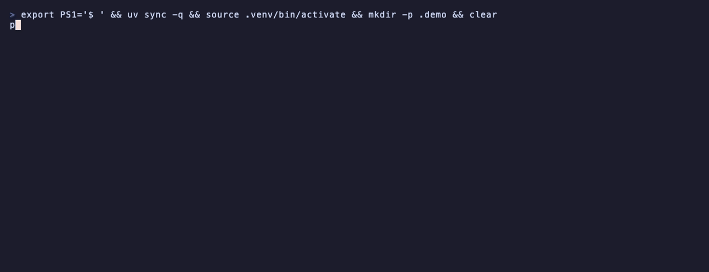
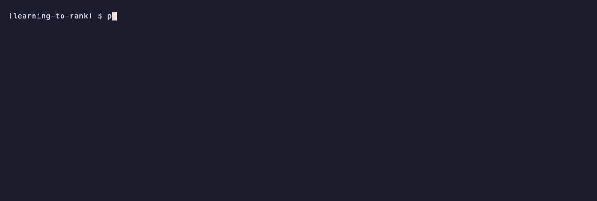
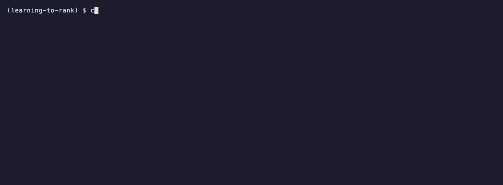

<h1 align="center">Learning To Rank</h1>

<p align="center">
  <em>LambdaMART with a Rust histogram core, neural rankers, click models and unbiased learning to rank, measured against LightGBM and XGBoost on MSLR-WEB10K and Istella-S.</em>
</p>

<p align="center">
  <a href="https://github.com/adeoluo/learning-to-rank/actions/workflows/ci.yml"></a>
  <a href="https://github.com/adeoluo/learning-to-rank/releases"></a>
  
  
  <a href="LICENSE"></a>
</p>

---

## Motivation

Ranking quality decides what the users of a search engine or an ads system see first, and
offline evaluation decides which ranker ships. Both need more than one headline number: the
learner has to be competitive with the libraries teams actually use, the comparison has to be on
identical data with a significance test, and the error analysis has to say which queries got
better or worse.

This project implements the standard learning-to-rank toolkit and measures every part of it:
LambdaMART on histogram trees with the hot loops in Rust, MLP rankers with pointwise, pairwise
and listwise losses, ranking metrics checked against reference implementations, click models and
inverse-propensity-weighted training from simulated clicks, paired significance tests, and
segment analysis by query popularity and length. The tree learner is compared with LightGBM
`lambdarank` and XGBoost `rank:ndcg` on the five MSLR-WEB10K folds (1,200,192 judged
query-document pairs) and on Istella-S (3,408,630 pairs).

## Architecture

<p align="center">
  
</p>

<sub>Legend: amber = entry points and external systems, indigo = core logic, green = data and state, blue = validation and control, grey = observability and outputs.</sub>

Requests enter through the CLI or the HTTP service, which validates shapes and limits. Loaders
turn MSLR-WEB10K and Istella-S into dense float32 matrices or 255-bin `uint8` matrices, and the
click simulator writes session logs. Training runs in the learning layer: LambdaRank gradients
and leaf-wise histogram trees in Rust (with a numpy reference that produces the same trees),
PBM and cascade click models with IPW targets, and PyTorch MLP rankers. Every score goes through
the same vectorized metrics, then through paired tests and segment reports; the service exports
Prometheus counters. Module-level detail is in [docs/ARCHITECTURE.md](docs/ARCHITECTURE.md).

## Results

All numbers below come from the scripts in [benchmarks/](benchmarks/), with raw JSON (including
per-query NDCG@10 and the machine description) in [benchmarks/results/](benchmarks/results/);
`uv run python benchmarks/report.py` prints every table here. Hardware: one Apple M1 (8 cores,
8 GB), shared with other jobs during the runs (1-minute load averages of 5 to 16 are recorded in
each result), so wall-clock times are indicative and comparable only within a table.

### LambdaMART against LightGBM and XGBoost, MSLR-WEB10K

MSLR-WEB10K: 10,000 queries, 1,200,192 judged documents, 136 features, five folds (three
partitions train, one validation, one test). Identical settings for every library: 500 trees,
learning rate 0.1, 31 leaves grown leaf-wise, at most 255 bins, minimum 20 documents per leaf,
8 threads, no early stopping, seed 0. Test metrics for all three libraries are computed by
`learning_to_rank.metrics` (NDCG with exponential gain `2^rel - 1`, a query without relevant
documents scores 1 as in LightGBM and XGBoost, see [ADR-0003](docs/adr/0003-lightgbm-lambdarank-definition-and-metric-conventions.md)).
Mean ± standard deviation over the five folds:

| Model | NDCG@1 | NDCG@3 | NDCG@5 | NDCG@10 | MAP | MRR | ERR@10 | Train s (500 trees) | Peak RSS MB |
|---|---:|---:|---:|---:|---:|---:|---:|---:|---:|
| LambdaMART, this package (Rust core) | 0.4872 ± 0.0080 | 0.4784 ± 0.0076 | 0.4849 ± 0.0077 | 0.5029 ± 0.0061 | 0.6133 ± 0.0036 | 0.8332 ± 0.0064 | 0.3600 ± 0.0067 | 68.1 ± 6.6 | 980 |
| LightGBM lambdarank | 0.4913 ± 0.0083 | 0.4808 ± 0.0073 | 0.4868 ± 0.0065 | 0.5042 ± 0.0056 | 0.6135 ± 0.0040 | 0.8357 ± 0.0064 | 0.3618 ± 0.0060 | 39.7 ± 2.9 | 1,159 |
| XGBoost rank:ndcg | 0.4942 ± 0.0090 | 0.4834 ± 0.0073 | 0.4892 ± 0.0071 | 0.5061 ± 0.0048 | 0.6147 ± 0.0034 | 0.8359 ± 0.0043 | 0.3639 ± 0.0068 | 81.5 ± 6.6 | 963 |

Per fold (test NDCG@10 and training seconds):

| Fold | Train docs | Test queries | This package | LightGBM | XGBoost | Fit s: ours / LightGBM / XGBoost |
|---|---:|---:|---:|---:|---:|---|
| 1 | 723,412 | 2,000 | 0.5044 | 0.5038 | 0.5072 | 78 / 43 / 88 |
| 2 | 716,683 | 2,000 | 0.5001 | 0.5024 | 0.5054 | 70 / 42 / 86 |
| 3 | 719,111 | 2,000 | 0.4937 | 0.4961 | 0.4983 | 67 / 40 / 84 |
| 4 | 718,768 | 2,000 | 0.5082 | 0.5093 | 0.5101 | 67 / 39 / 76 |
| 5 | 722,602 | 2,000 | 0.5081 | 0.5095 | 0.5097 | 59 / 35 / 73 |

Paired tests over all 10,000 queries (each query is a test query in exactly one fold), against
LightGBM: 95% t interval of the mean difference, two-sided t-test and randomization test with
10,000 sign flips.

| System vs LightGBM | Mean NDCG@10 | Difference | 95% CI | t-test p | Randomization p | Wins / ties / losses |
|---|---:|---:|---|---:|---:|---|
| LambdaMART (this package) | 0.5029 | -0.0013 | [-0.0028, +0.0003] | 0.103 | 0.107 | 4,515 / 778 / 4,707 |
| XGBoost | 0.5061 | +0.0019 | [+0.0005, +0.0034] | 0.00932 | 0.0097 | 4,677 / 827 / 4,496 |
| MLP, ListNet | 0.4907 | -0.0135 | [-0.0157, -0.0113] | 1.15e-32 | 0.0001 | 4,170 / 582 / 5,248 |
| MLP, RankNet | 0.4841 | -0.0201 | [-0.0224, -0.0177] | 5.61e-61 | 0.0001 | 4,112 / 573 / 5,315 |

Reading: our LambdaMART is 0.0013 NDCG@10 below LightGBM, a difference that is not significant
(p = 0.10); XGBoost is 0.0019 above LightGBM, which is significant (p = 0.01). LightGBM trains
1.7 times faster than this package; XGBoost is the slowest of the three. Peak memory is similar.

### Istella-S

Istella-S: 33,018 queries and 3,408,630 judged documents with 220 features, split by Istella into
train (19,245 queries, 2,043,304 documents), validation (7,211 queries) and test (6,562 queries,
681,250 documents). As float32 the training matrix alone is 1.8 GB, so the archive is converted
once into 255-bin `uint8` matrices and all three libraries train on the same bin indices
([ADR-0005](docs/adr/0005-istella-as-shared-binned-matrices.md)). Same settings as on MSLR, one
run per library on the official split; training time includes LightGBM's and XGBoost's own
dataset construction from the bins (11 s and 15 s).

| Model | NDCG@1 | NDCG@5 | NDCG@10 | MAP | MRR | ERR@10 | Train s (500 trees) | Peak RSS MB |
|---|---:|---:|---:|---:|---:|---:|---:|---:|
| LambdaMART, this package (Rust core) | 0.7100 | 0.6992 | 0.7603 | 0.8714 | 0.9694 | 0.7516 | 496 | 1,040 |
| LightGBM lambdarank | 0.7039 | 0.6976 | 0.7595 | 0.8714 | 0.9688 | 0.7485 | 203 | 1,152 |
| XGBoost rank:ndcg | 0.7042 | 0.6935 | 0.7554 | 0.8662 | 0.9687 | 0.7480 | 391 | 1,595 |

Paired tests of test NDCG@10 over the 6,562 test queries:

| System vs LightGBM | Difference | 95% CI | t-test p | Randomization p |
|---|---:|---|---:|---:|
| LambdaMART (this package) | +0.0008 | [-0.0004, +0.0020] | 0.197 | 0.204 |
| XGBoost | -0.0040 | [-0.0053, -0.0027] | 9.4e-10 | 0.0001 |

On Istella-S our LambdaMART and LightGBM are level (+0.0008, p = 0.20) and XGBoost is
significantly lower. LightGBM trains 2.4 times faster than this package here.

### Neural rankers

The same MLP (136, 256, 256, 128, 1 with ReLU and dropout 0.1), Adam at 1e-3, up to 30 epochs
with early stopping on validation NDCG@10 (patience 5), seed 0, PyTorch on Apple MPS. Mean ±
standard deviation over the five MSLR-WEB10K folds:

| Model | NDCG@1 | NDCG@3 | NDCG@5 | NDCG@10 | MAP | MRR | ERR@10 | Train s |
|---|---:|---:|---:|---:|---:|---:|---:|---:|
| MLP, pointwise | 0.4669 ± 0.0069 | 0.4595 ± 0.0066 | 0.4672 ± 0.0049 | 0.4867 ± 0.0039 | 0.6143 ± 0.0034 | 0.8308 ± 0.0036 | 0.3460 ± 0.0035 | 187 ± 117 |
| MLP, ranknet | 0.4538 ± 0.0093 | 0.4546 ± 0.0073 | 0.4631 ± 0.0068 | 0.4841 ± 0.0067 | 0.6190 ± 0.0040 | 0.8395 ± 0.0068 | 0.3357 ± 0.0078 | 232 ± 204 |
| MLP, lambdarank | 0.4811 ± 0.0112 | 0.4638 ± 0.0082 | 0.4682 ± 0.0061 | 0.4861 ± 0.0048 | 0.6083 ± 0.0026 | 0.8310 ± 0.0070 | 0.3498 ± 0.0076 | 273 ± 227 |
| MLP, listnet | 0.4728 ± 0.0084 | 0.4628 ± 0.0072 | 0.4692 ± 0.0062 | 0.4907 ± 0.0059 | 0.6065 ± 0.0038 | 0.8165 ± 0.0052 | 0.3536 ± 0.0058 | 349 ± 228 |

ListNet is the best of the four losses at NDCG@10, and every MLP is below the tree ensembles
(by 0.013 to 0.020 NDCG@10, all significant). RankNet has the best MAP and MRR of any model in this
README, metrics that reward placing any relevant document high rather than the graded order. The large spread in training
time comes from the shared GPU, not from the losses.

### Segment analysis

Popularity: MSLR has no query frequencies, so a query's popularity is the total logged
query-url clicks of its documents (feature 134); head is the top 10 percent of queries, torso the
next 40 percent, tail the bottom 50 percent. Query length is recovered from the covered-term
features. Mean NDCG@10 over all 10,000 queries; `*` marks a difference from LightGBM that is
significant at 0.05 after Holm adjustment across segments (randomization test).

| Segment | Queries | LambdaMART (this package) | LightGBM | XGBoost | MLP, ListNet | MLP, RankNet |
|---|---:|---:|---:|---:|---:|---:|
| head | 1,000 | 0.5146 | 0.5133 | 0.5100 | 0.4972 * | 0.4653 * |
| torso | 4,000 | 0.5386 | 0.5397 | 0.5407 | 0.5231 * | 0.5128 * |
| tail | 5,000 | 0.4720 | 0.4740 | 0.4777 * | 0.4635 * | 0.4650 * |

| Query length (terms) | Queries | LambdaMART (this package) | LightGBM | XGBoost | MLP, ListNet | MLP, RankNet |
|---|---:|---:|---:|---:|---:|---:|
| 1 | 1,938 | 0.5379 | 0.5364 | 0.5367 | 0.5129 * | 0.4990 * |
| 2 | 3,723 | 0.5007 | 0.5025 | 0.5045 | 0.4870 * | 0.4804 * |
| 3 | 2,459 | 0.4948 | 0.4967 | 0.5000 | 0.4877 * | 0.4835 * |
| 4 | 1,087 | 0.4833 | 0.4862 | 0.4870 | 0.4778 * | 0.4769 * |
| 5+ | 610 | 0.5075 | 0.5092 | 0.5125 | 0.5167 | 0.5193 * |
| unknown | 183 | 0.3880 | 0.3893 | 0.3901 | 0.3617 * | 0.3380 * |

Tail queries are the hardest for every model (0.05 to 0.07 below the torso). XGBoost's lead over
LightGBM is significant only in the tail; on head queries it is behind. Our LambdaMART and
LightGBM are within 0.003 of each other in every segment, with no significant difference. The
MLPs trail the trees in almost every segment (RankNet by 0.048 on head queries) but are level with
or ahead of them on queries of five or more terms, the one segment where RankNet beats LightGBM
significantly.

### Unbiased learning to rank from simulated clicks

Protocol ([ADR-0006](docs/adr/0006-click-simulation-and-ipw-targets.md)): a weak production
LambdaMART (30 trees, 60 random training queries) ranks the 6,000 fold 1 training queries;
2,000,000 simulated sessions show the top 10, with clicks from the position-based model,
examination `(1/rank)^eta`, click noise 0.1 and swap interventions in 10 percent of sessions.
LambdaMART (squared error, 300 trees, learning rate 0.05) is trained on the 59,436 shown
documents with each target, and evaluated on the fold 1 test queries with the true labels. Mean
± standard deviation over seeds 0, 1, 2:

| Training signal | NDCG@10, eta 1 | ERR@10, eta 1 | NDCG@10, eta 2 | ERR@10, eta 2 |
|---|---:|---:|---:|---:|
| Production ranker (30 trees, 60 queries) | 0.4089 ± 0.0038 | 0.2919 ± 0.0037 | 0.4089 ± 0.0038 | 0.2919 ± 0.0037 |
| Naive: click-through rate as target | 0.4432 ± 0.0085 | 0.3328 ± 0.0044 | 0.4181 ± 0.0061 | 0.3203 ± 0.0026 |
| IPW, true propensities | 0.4646 ± 0.0084 | 0.3455 ± 0.0064 | 0.4552 ± 0.0068 | 0.3403 ± 0.0055 |
| IPW, swap-intervention propensities | 0.4646 ± 0.0077 | 0.3464 ± 0.0051 | 0.4540 ± 0.0089 | 0.3409 ± 0.0039 |
| IPW, EM (PBM) propensities | 0.4655 ± 0.0071 | 0.3458 ± 0.0035 | 0.4506 ± 0.0090 | 0.3386 ± 0.0050 |
| Skyline: true labels of the shown documents | 0.4677 ± 0.0057 | 0.3472 ± 0.0036 | 0.4677 ± 0.0057 | 0.3472 ± 0.0036 |
| Supervised, all 723,412 labelled training documents (500 trees) | 0.5044 | 0.3586 | 0.5044 | 0.3586 |

IPW closes most of the gap between naive click training and the full-information skyline: at
eta 1 it recovers 0.021 of the 0.025 NDCG@10 gap, at eta 2 (stronger position bias) 0.032 to 0.037
of 0.050. Propensities estimated from swap interventions or by EM work as well as the true ones
at eta 1; at eta 2 EM is 0.005 behind. For seed 0 the estimated examination curves match the
truth to within 0.02 at every rank (`propensities` in
[ultr_mslr.json](benchmarks/results/ultr_mslr.json)).

Click models fitted on 80 percent of 2,000,000 sessions, held-out perplexity (lower is better):

| Users simulated as | PBM (EM) | Cascade | CTR by rank |
|---|---:|---:|---:|
| pbm | 1.2136 | 1.4482 | 1.2488 |
| cascade | 1.2709 | 1.2096 | 1.3202 |

Each click model fits best on the clicks of its own user model, which is the sanity check that
the EM and cascade estimators are right.

### Training speed

50 trees on fold 1 (723,412 documents), wall-clock seconds by thread count (`RAYON_NUM_THREADS`
for this package, `num_threads` for LightGBM), each run in its own process:

| Threads | 1 | 2 | 4 | 8 |
|---|---:|---:|---:|---:|
| This package, s | 95.1 | 46.8 | 27.5 | 26.5 |
| LightGBM, s | 48.6 | 24.4 | 20.8 | 23.5 |

Single-threaded, LightGBM is twice as fast; this package speeds up 3.5 times from 1 to 4 threads.
Neither gains from 8 threads here because other jobs held 5 to 10 cores during the run. The Rust
core trains 5 trees on 300 queries (34,029 documents) in 0.38 s against 9.5 s for the numpy
reference that produces the same trees, and computes LambdaRank gradients for all 723,412
documents in 0.078 s (on the small set the Rust gradients are about 250 times faster than the
reference). Per tree, histogram
building takes 0.35 s, gradients 0.10 s, partitioning 0.02 s and split search 0.01 s
([throughput.json](benchmarks/results/throughput.json)).

### Metric correctness

NDCG@k, MAP, MRR, ERR@k and precision@k are checked against scikit-learn `ndcg_score` in the
unit tests, against ranx and LightGBM's own NDCG evaluation in the validation group, and against a
direct per-query reference in property-based tests.

## Quickstart

```bash
git clone https://github.com/adeoluo/learning-to-rank && cd learning-to-rank
make setup     # uv sync with every extra (builds the Rust core with maturin), pre-commit
make test
```

```python
from learning_to_rank import LambdaMART, evaluate
from learning_to_rank.data import synthetic

train, test = synthetic(400, seed=1), synthetic(200, seed=2)
model = LambdaMART(n_estimators=100).fit(train)
print(evaluate(test, model.predict(test))["ndcg@10"])
```

Prebuilt wheels (macOS arm64 and Linux x86_64) are attached to the
[releases](https://github.com/adeoluo/learning-to-rank/releases).

## Usage

### Data

```bash
make data      # MSLR-WEB10K (431 MB parquet) and Istella-S (472 MB) into ../.bench-data/learning-to-rank
SKIP_ISTELLA=1 make data   # MSLR-WEB10K only
```

### Command line

```bash
D=../.bench-data/learning-to-rank/mslr10k
python -m learning_to_rank info
python -m learning_to_rank train --data $D --fold 1 --trees 500 --model lm.json
python -m learning_to_rank train --data $D --fold 1 --ranker neural --loss listnet --model mlp.pt
python -m learning_to_rank evaluate --data $D --fold 1 --model lm.json mlp.pt
python -m learning_to_rank compare --data $D --fold 1 lm.json mlp.pt     # paired t and randomization tests
python -m learning_to_rank clicks --data $D --sessions 2000000 --click-model pbm --eta 1
python -m learning_to_rank train --train-file train.txt --valid-file vali.txt --model lm.json   # any LETOR file
```

### Library API

```python
from learning_to_rank import LambdaMART, evaluate
from learning_to_rank.datasets import load_mslr_fold
from learning_to_rank.metrics import per_query
from learning_to_rank.significance import compare

train, valid, test = load_mslr_fold("../.bench-data/learning-to-rank/mslr10k", 1)
a = LambdaMART(n_estimators=500).fit(train, valid)
b = LambdaMART(n_estimators=500, objective="regression").fit(train, valid)
qa = per_query(test.y, a.predict(test), test.offsets)["ndcg@10"]
qb = per_query(test.y, b.predict(test), test.offsets)["ndcg@10"]
print(evaluate(test, a.predict(test)), compare(qa, qb).to_dict())
a.save("lm.json")
```

`learning_to_rank.neural.NeuralRanker`, `learning_to_rank.clicks` (simulation, PBM, cascade,
swap propensities), `learning_to_rank.unbiased` (naive and IPW targets) and
`learning_to_rank.segments` follow the same pattern.

### HTTP service

```bash
python -m learning_to_rank serve --model lm.json --port 8000
curl -s localhost:8000/rank -d '{"documents": [[...136 features...], ...], "ids": ["a", "b"], "top_k": 10}'
```

Routes: `GET /health`, `/ready`, `/metrics` (Prometheus text), `/model`; `POST /rank` (ranked
ids and scores) and `/score` (raw scores). Requests are validated and capped at 100,000 documents
and 64 MB. `make docker-up` runs the service in a container.

### Benchmarks

```bash
uv run --group validation python benchmarks/gbdt_mslr.py all     # 15 runs, about 30 minutes
uv run --extra neural python benchmarks/neural_mslr.py all        # 20 runs
uv run python benchmarks/ultr_mslr.py
uv run python benchmarks/segments_mslr.py                         # needs the two above
uv run --group validation python benchmarks/throughput.py
uv run --group validation python benchmarks/istella.py prepare && uv run --group validation python benchmarks/istella.py all
uv run python benchmarks/report.py
```

### Demos

Recorded from real runs with [vhs](https://github.com/charmbracelet/vhs); each tape is in `docs/demo/`.

Training LambdaMART on 2,000 MSLR-WEB10K training queries, with validation NDCG@10 while it boosts and test metrics at the end.

<p align="center">
  
</p>

Evaluating a LambdaRank and a squared-error model on the same test queries, then the paired significance test between them.

<p align="center">
  
</p>

Simulating 500,000 search sessions under the position-based model and recovering the examination propensities by swap interventions and by EM.

<p align="center">
  
</p>

The HTTP service ranking six documents of a test query (ids carry their true grade) and its Prometheus metrics.

<p align="center">
  
</p>

## Design decisions

- [ADR-0002](docs/adr/0002-rust-histogram-core-with-numpy-reference.md): the hot loops
  (gradients, histograms, split search, partitioning) are in Rust with rayon, and a numpy
  reference that grows the same trees is kept for parity tests.
- [ADR-0003](docs/adr/0003-lightgbm-lambdarank-definition-and-metric-conventions.md): LambdaRank
  follows LightGBM's definition (sigmoid 1, truncation at 30, normalised by max DCG), and every
  metric convention is stated, so the comparison is like for like.
- [ADR-0004](docs/adr/0004-mslr-folds-from-the-parquet-mirror.md): the five MSLR-WEB10K folds are
  rebuilt from the Fold 1 parquet mirror; the fold 1 row counts match the published ones.
- [ADR-0005](docs/adr/0005-istella-as-shared-binned-matrices.md): Istella-S is stored once as
  255-bin `uint8` matrices that all three libraries train on, to fit in memory.
- [ADR-0006](docs/adr/0006-click-simulation-and-ipw-targets.md): semi-synthetic clicks with swap
  interventions, and IPW targets that are linear in clicks so a squared-error tree learner can
  use them.

## Testing

```bash
make all          # ruff format and lint, mypy, pytest with an 80 percent coverage gate
make parity       # Rust core against the numpy reference
make validation   # metrics and models against LightGBM, XGBoost, scikit-learn and ranx
make rust-check   # cargo fmt, clippy and the Rust unit tests
```

124 Python tests (98 percent line coverage) and 23 Rust unit tests. They include property-based
tests (hypothesis) for the metrics, binning, LETOR parsing, significance tests and Rust parity;
parity tests that require the Rust trainer and the numpy reference to grow identical trees;
validation tests against scikit-learn, ranx, LightGBM and XGBoost (a separate CI job);
adversarial inputs for the service (malformed JSON, empty or ragged matrices, non-numeric and
non-finite values, bad ids and `top_k`, too many documents) and the model loader (out-of-range child and leaf indices); and end-to-end CLI tests. CI uses
small bundled and synthetic fixtures; the full-scale runs are the benchmark scripts.

## Responsible AI

- Data: MSLR-WEB10K and Istella-S are public research datasets with anonymised numeric features
  and no query text; the click logs are simulated, so no user data is involved. Istella-S is
  used under its non-commercial licence and is not redistributed. See
  [DATA_CARD.md](docs/DATA_CARD.md).
- Rankers learn whatever the labels or clicks reward. Models trained from clicks inherit
  position, presentation and popularity bias; IPW corrects only the position bias it models, and
  only as well as the propensities are estimated. See [MODEL_CARD.md](docs/MODEL_CARD.md).
- The segment analysis exists because averages hide groups: tail queries are served worse by
  every model here, and changes should be checked per segment before shipping.
- The service validates inputs and loads only JSON trees or weights-only checkpoints; see
  [THREAT_MODEL.md](docs/THREAT_MODEL.md).

## Limitations

- LightGBM trains 1.7 times (MSLR-WEB10K) to 2.4 times (Istella-S) faster at the same settings, and twice as fast single-threaded.
  Histogram building is 73 percent of this package's time per tree and is where the gap is.
- One hyperparameter setting (LightGBM-style defaults, 500 trees) for all libraries; no
  per-library tuning, so the ranking between libraries could change under tuning.
- Timings were taken on a shared laptop; repeat runs vary by up to about 10 percent for the
  trees and more for the GPU-trained MLPs.
- The click simulation follows PBM and cascade users; real users show trust bias, context
  effects and query-dependent examination that are not modelled. Popularity segments use logged
  clicks as a proxy because MSLR has no query frequencies.
- Neural rankers are plain MLPs on the 136 features; no transformers or attention over the list.

## Roadmap

- Early stopping and learning-rate schedules in the benchmark protocol, and a small tuning study
  per library.
- Dual learning algorithm and regression EM for unbiased learning to rank with trust bias.
- Listwise neural rankers with self-attention over the candidate list.
- Yahoo! Learning to Rank Challenge data if it becomes downloadable without a request form.

## License

Released under the [MIT License](LICENSE).
