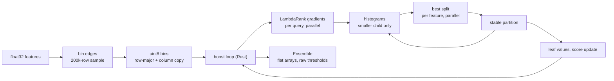

# Architecture

The package is a Python library with a Rust extension compiled in. Python owns data handling,
evaluation, neural rankers, click models and the interfaces; Rust owns the loops that dominate
training time. Every Rust routine has a numpy twin used as the reference in parity tests.

```
src/learning_to_rank/
  data.py            RankingData (dense float32 features, labels, query ids, offsets), LETOR I/O
  datasets.py        MSLR-WEB10K five-fold assembly, Istella-S binning, query length and popularity
  binning.py         bin edges (greedy equal-frequency over distinct values) and uint8 mapping
  gbdt.py            LambdaMART estimator, Ensemble (flat tree arrays), JSON save and load
  gbdt_reference.py  numpy reference of gradients, histograms, splits and tree growth
  metrics.py         vectorized NDCG@k, MAP, MRR, ERR@k, precision@k per query
  neural.py          MLP ranker with pointwise, RankNet, LambdaRank, ListNet and softmax losses
  clicks.py          click simulation (PBM, cascade, swap interventions) and click models
  unbiased.py        naive and inverse-propensity-weighted click targets
  significance.py    paired t-test, randomization test, bootstrap interval, Holm adjustment
  segments.py        head / torso / tail and query-length segments with per-segment tests
  cli.py, service.py, observability.py   command line, HTTP service, Prometheus metrics
rust/src/
  svmlight.rs        parallel LETOR parser
  binning.rs         edge fitting and parallel binning
  lambda.rs          LambdaRank gradients and hessians per query (rayon)
  tree.rs            histogram building, split finding, leaf-wise growth, stable partition
  boost.rs           boosting loop, feature subsampling, validation NDCG, prediction
  metrics.rs         NDCG for early stopping
  python.rs          PyO3 bindings (buffer protocol in, bytes out, GIL released)
```

## Training path (LambdaMART)



1. `BinMapper.fit` picks up to 255 edges per feature from a 200,000-row sample. Edges are
   observed values, so "bin <= t" is exactly "x <= edges[t]" and the model predicts on raw
   features.
2. `Booster` (Rust) copies the bins once, adds a feature-major copy for partitioning, caches gains
   `2^y - 1`, the discount table and `1 / maxDCG@30` per query.
3. Each iteration computes LambdaRank gradients for all queries in parallel, grows one tree
   leaf-wise to 31 leaves, adds the shrunken leaf values to the training scores and, with
   validation data, updates validation scores and NDCG@10 for early stopping.
4. Within a tree: the root histogram is built over all rows; for every split the smaller child's
   histogram is built and the larger child's is the parent minus the smaller one. Leaves with at
   least 65,536 rows use row chunks (one per 16,384 rows, up to 16) summed in chunk order;
   smaller leaves are built feature-parallel. Split search scans every feature's bins in
   parallel; ties keep the lower feature and bin.
5. The ensemble is exported as flat arrays (node and leaf offsets, split features, raw
   thresholds, child pointers, leaf values) and saved as JSON.

## Click and unbiased-learning path

`simulate_clicks` ranks each training query with a production model, shows the top 10 and draws
clicks from the PBM or cascade model (optionally with swap interventions). `fit_pbm` runs EM on
per (document, rank) click and impression counts; `swap_propensity` estimates examination from
the swapped sessions; `click_targets` turns the log into naive or IPW targets per shown
document, which train LambdaMART with the squared-error objective.

## Evaluation path

All libraries' scores go through `metrics.per_query`, which ranks each query with a stable
sort, pads queries into blocks and computes every metric with vectorized numpy. `significance`
compares per-query values of two systems; `segments` groups queries and adjusts p-values across
segments.

## Service

`service.App` is independent of the socket layer: it validates JSON, scores with the loaded
model (LambdaMART or neural), ranks with a stable sort and records Prometheus counters;
`make_handler` wraps it in a `ThreadingHTTPServer`.
